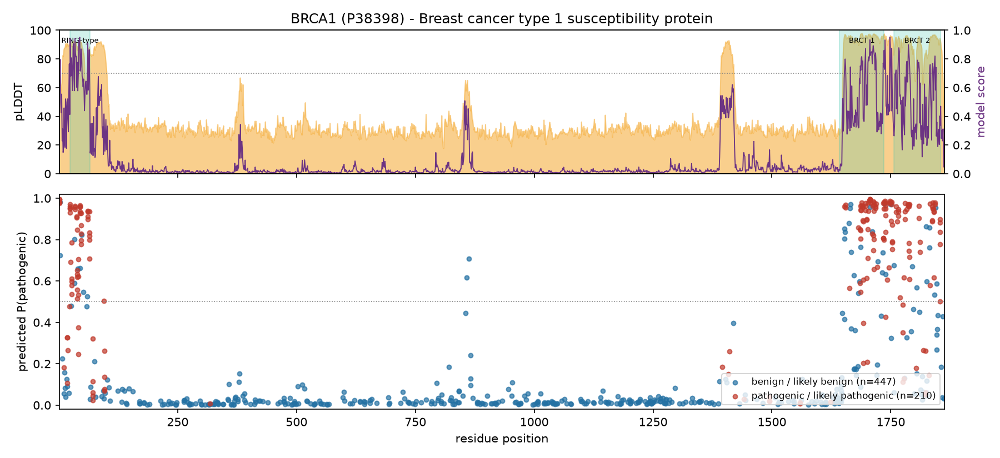
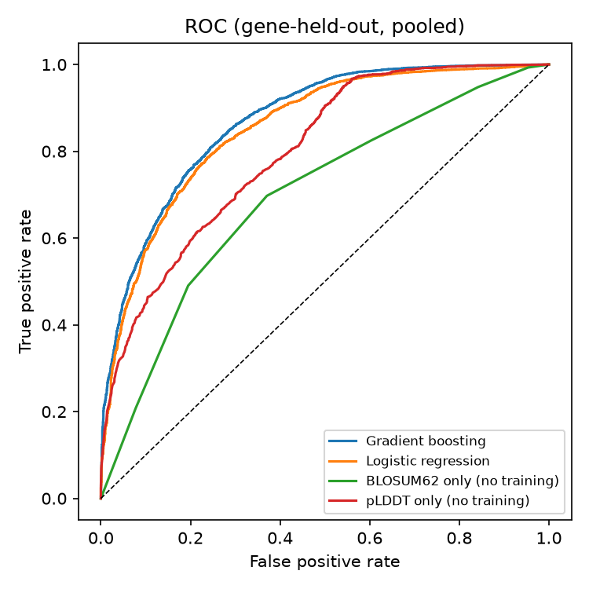
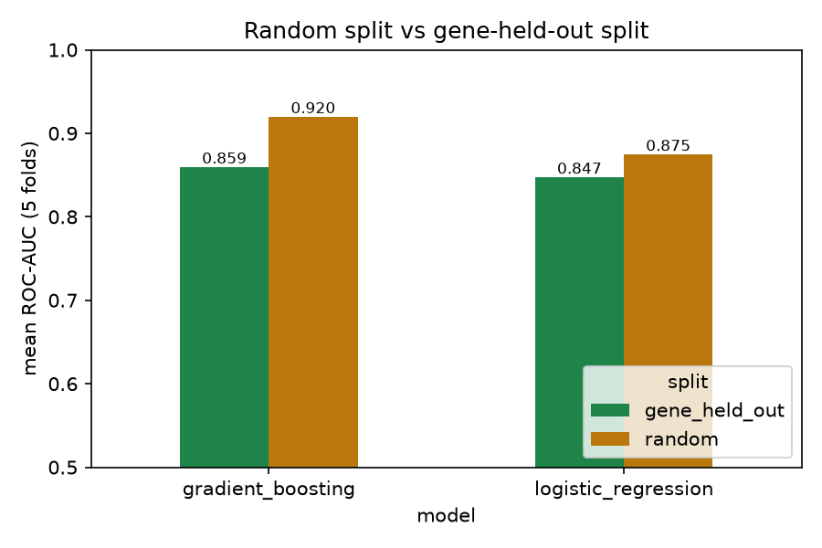
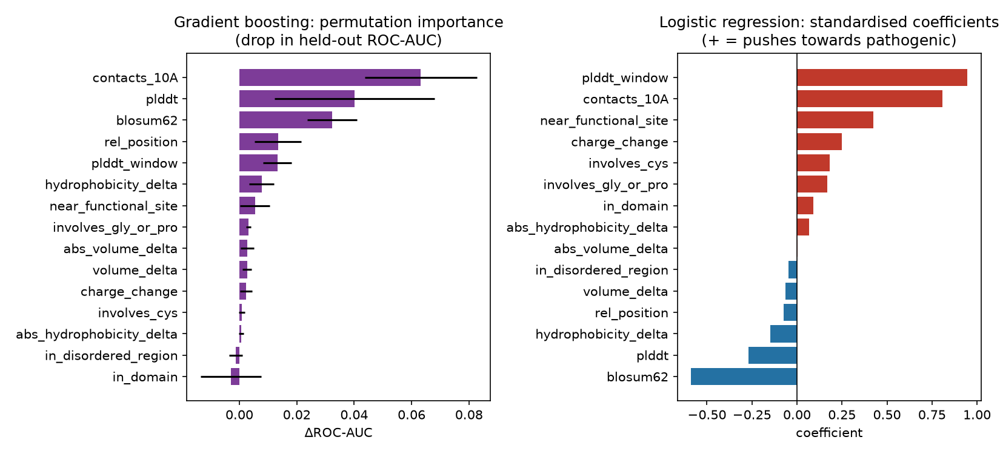
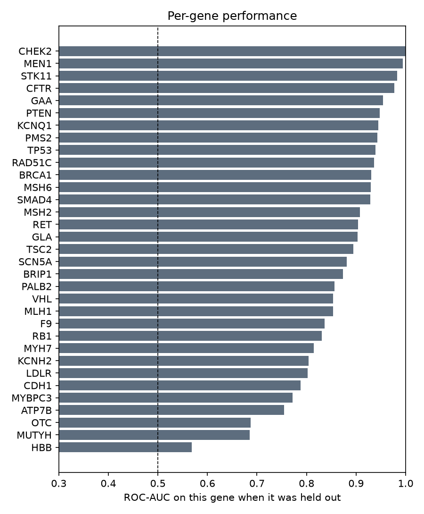
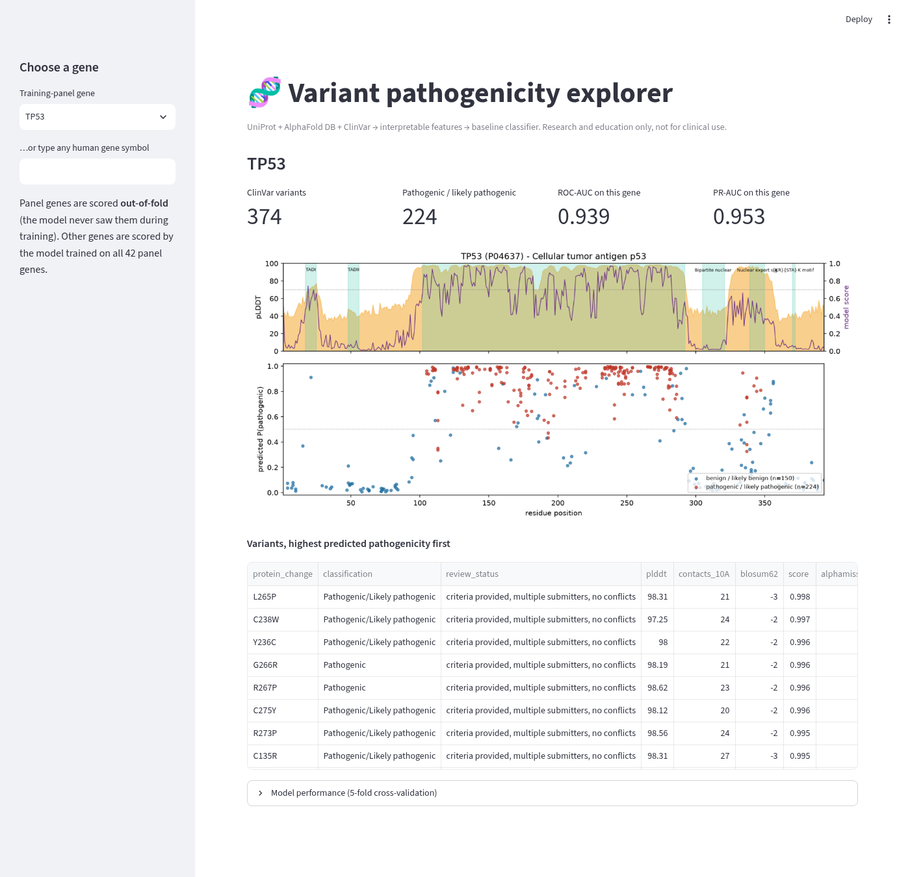

# Variant Pathogenicity Explorer

[](https://github.com/zainab-123-spec/variant-pathogenicity-explorer/actions/workflows/tests.yml)
[](LICENSE)
[](https://www.python.org/)
[](https://github.com/astral-sh/ruff)

**Can protein structure explain why a missense variant causes disease, even in a gene the model has never seen?**

This project joins three public bioinformatics APIs (**UniProt**, **AlphaFold DB** and **NCBI ClinVar**) into one cached pipeline. It turns each ClinVar missense variant into 15 interpretable features and trains two classifiers. It evaluates them with **gene-held-out cross-validation**, which is the honest test for this problem.


*BRCA1 (`python -m vpe analyze BRCA1`). Top: AlphaFold confidence (pLDDT), UniProt domains and the model's mean score per residue. Bottom: ClinVar variants coloured by their label and placed by their out-of-fold predicted probability (ROC-AUC 0.931 on this gene, which was held out of training).*

> Research and teaching project. **Not for clinical use.**

---

## Results (real numbers from `python -m vpe train`)

Dataset: **8,184** ClinVar missense variants (review status of at least one star: "no assertion criteria provided" removed) across **42** genes. 6,049 are pathogenic or likely pathogenic and 2,135 are benign or likely benign (positive rate 0.739).

### Cross-validation, 5 folds

| Model | Split | ROC-AUC (mean ± sd over folds) | PR-AUC (mean ± sd) |
|---|---|---|---|
| Logistic regression | **gene-held-out** | **0.847 ± 0.053** | **0.931 ± 0.035** |
| Gradient boosting | **gene-held-out** | **0.859 ± 0.040** | **0.939 ± 0.028** |
| Logistic regression | random (leaky) | 0.875 ± 0.010 | 0.947 ± 0.005 |
| Gradient boosting | random (leaky) | 0.920 ± 0.006 | 0.967 ± 0.002 |

Pooled out-of-fold values for the gene-held-out split are ROC-AUC 0.854 (LR) and 0.870 (GB).

### Baselines and reference (a single score, no training, same variants)

| Score | n | ROC-AUC | PR-AUC |
|---|---|---|---|
| BLOSUM62 substitution score | 8,184 | 0.697 | 0.840 |
| AlphaFold pLDDT at the residue | 8,184 | 0.798 | 0.911 |
| *AlphaMissense (reference only)* | 8,033 | *0.931* | *0.972* |

**About AlphaMissense:** it is a large published deep-learning model that uses evolutionary information from many species. We show it as a **reference ceiling** to put our numbers in context. It is not a competitor, and it is **never used as an input feature**. Some ClinVar labels may also have been influenced by computational predictors, so its number may be optimistic.

### Gene-level view

* 33 genes have at least 5 variants of each class, so they can be evaluated on their own. Their **median held-out ROC-AUC is 0.894** and 27 of the 33 are above 0.8. The weakest are HBB (0.568) and OTC (0.687) ([per_gene_auc.csv](results/per_gene_auc.csv)).
* **Genes outside the panel** (final model trained on all 42 panel genes):

| Gene | n | Pathogenic / benign | ROC-AUC | Note |
|---|---|---|---|---|
| SCN1A | 1,052 | 991 / 61 | 0.905 | AlphaMissense gets 0.967 on the same set |
| FBN1 | 1,467 | 1,401 / 66 | 0.925 | no AlphaFold model (protein too long) |
| BRCA2 | 819 | 116 / 703 | 0.799 | no AlphaFold model |
| ATM | 259 | 96 / 163 | 0.743 | no AlphaFold model |
| APC | 86 | 20 / 66 | 0.635 | no AlphaFold model |

When a protein has no structure, the structure features are missing and only the sequence features are used. Performance drops for these genes, which is what we expect.

### What the model uses

Grouped permutation importance (drop in ROC-AUC on held-out genes) for gradient boosting: **contacts within 10 Å** 0.063, **pLDDT** 0.040, **BLOSUM62** 0.032, relative position 0.013 and pLDDT window 0.013. All the others are below 0.01. A pathogenic variant is usually a *buried residue in a confidently folded region, with a chemically unusual swap*.

| | |
|---|---|
|  |  |
|  |  |

## Why gene-held-out matters

Variants from the same gene share a lot: the same protein, the same domains and often a similar mix of labels. MEN1, for example, is 95% pathogenic in our data, and CDH1 is 88% benign. With a **random split**, variants of every gene appear in both training and test data. The model can then score well by learning things like "residues 200-300 of this protein are bad". That does not help with a *new* gene.

**GroupKFold by gene** keeps each gene completely out of training while it is tested. In this project the random split makes gradient boosting look **+0.060 ROC-AUC better** (0.920 vs 0.859). The flexible model gains most from leakage, while logistic regression gains only +0.027. The gene-held-out numbers are the ones we report.

## Interactive app

```bash
streamlit run app.py            # then open http://localhost:8501  (or ?gene=TP53)
```



Pick any panel gene, or type any human gene symbol. The app fetches the data, scores every variant and shows the track, summary metrics and a sortable table. The screenshot was taken headlessly with `scripts/screenshot_app.py` (Playwright + Chrome).

## How it works

```
UniProt REST ──► sequence, domains, sites, disorder ┐
AlphaFold DB ──► pLDDT per residue, Cα coordinates   ├─► features.py ─► dataset.py ─► model.py ─► report.py / app.py
NCBI E-utilities (ClinVar) ──► labelled missense     ┘        (15 features)   (QC)      (CV, importance)
```

| API | Used for | Docs |
|---|---|---|
| UniProt REST (`rest.uniprot.org/uniprotkb/search`) | canonical sequence and annotated features (reviewed human entry, primary gene name must match exactly) | [uniprot.org/help/api](https://www.uniprot.org/help/api) |
| AlphaFold DB (`/api/prediction/{accession}`) | pLDDT, PDB coordinates and AlphaMissense scores (reference only) | [alphafold.ebi.ac.uk/api-docs](https://alphafold.ebi.ac.uk/api-docs) |
| NCBI E-utilities `esearch` + `esummary` on `db=clinvar` | missense variants, germline classification and review status | [E-utilities book](https://www.ncbi.nlm.nih.gov/books/NBK25501/) |

**Engineering details**
* `vpe/http.py` gives one `CachedSession` for every API. It caches responses on disk (including 404s), rate-limits NCBI to under 3 requests per second (10 with `NCBI_API_KEY`), retries 429/5xx with back-off and has an `--offline` mode.
* **QC**: the reference amino acid in each ClinVar variant must match the UniProt canonical sequence at that position. If it does not (isoform numbering), the variant is dropped. A protein change with conflicting labels is also dropped. This check found a real bug: a synonym search mapped *CDH1* to FZR1 and *GLA* to another protein. It was fixed by requiring an exact primary gene name.
* **Features** (`vpe/features.py`): pLDDT, pLDDT ±5 window, number of Cα atoms within 10 Å, relative position, BLOSUM62, hydrophobicity and volume change (signed and absolute), charge change, in UniProt domain, in disordered region, within 3 residues of a functional site, Gly/Pro involved, Cys involved.
* **Models** (`vpe/model.py`): median imputation + standardised **logistic regression** (class-balanced), and **HistGradientBoosting** (regularised: 15 leaves, at least 40 samples per leaf). Both use `GroupKFold(5)` by gene and are compared against `StratifiedKFold`.

## Reproduce

```bash
git clone https://github.com/zainab-123-spec/variant-pathogenicity-explorer.git
cd variant-pathogenicity-explorer
python -m venv .venv && source .venv/bin/activate
pip install -r requirements-dev.txt

python -m vpe build-dataset        # ~2 min the first time (API calls), ~25 s from cache
python -m vpe train                # ~15 s, writes results/ and docs/figures/
python -m vpe analyze BRCA1        # reports/BRCA1.html + BRCA1_track.png
python -m vpe analyze SCN1A        # works for genes outside the panel too
streamlit run app.py

python -m pytest -q                # 32 tests, all APIs mocked, no network
ruff check . && ruff format --check .
jupyter nbconvert --to notebook --execute notebooks/walkthrough.ipynb
```

Optional: `export NCBI_API_KEY=...` makes ClinVar downloads faster. All model randomness is seeded (`random_state=42`), so re-training on the same `data/processed/variants.csv` gives the same numbers. ClinVar is updated every week, so rebuilding the dataset later can change the counts a little.

## Project layout

```
vpe/            http.py  uniprot.py  alphafold.py  clinvar.py  aminoacids.py
                features.py  dataset.py  genes.py  model.py  report.py  cli.py
app.py          Streamlit explorer
notebooks/      walkthrough.ipynb (executed)
tests/          pytest suite with a fake HTTP session and toy protein
data/processed/ variants.csv, gene_qc.csv   (data/cache/ is git-ignored)
results/        metrics.json, cv_metrics.csv, baselines.csv, per-gene and importance tables, index.html
docs/figures/   all figures used here
LEARNING_GUIDE.md  simple-English explanation and interview Q&A
```

## Limitations

* **Isoform mismatches**: 299 of 8,483 labelled variants (3.5%) were dropped because ClinVar numbers them on a different isoform. Most come from MUTYH (189 of 201), SCN5A (71) and G6PD (39). Mapping isoforms would recover them.
* **Label bias**: ClinVar is enriched for well-studied genes and easy cases. Some labels may already have used computational predictors. Variants of uncertain significance (VUS), which are the cases that matter most in practice, cannot be evaluated.
* **Class imbalance per gene**: many genes are almost all pathogenic (PAH 489/490) or mostly benign. 9 genes cannot be evaluated on their own. PR-AUC values look high partly because 74% of the variants are positive, so compare them with that 0.739 base rate.
* **No structure for long proteins**: AlphaFold DB has no single-chain model for proteins such as BRCA2, ATM, APC and FBN1, so those genes use sequence features only.
* **No evolutionary conservation**: this is the strongest known signal, and the main reason AlphaMissense scores higher. It is the obvious next feature to add.
* Monomer AlphaFold models only: no protein–protein or DNA interfaces.

## License

MIT, see [LICENSE](LICENSE). Data: UniProt (CC BY 4.0), AlphaFold DB (CC BY 4.0), ClinVar (public domain). Please cite the original resources.
